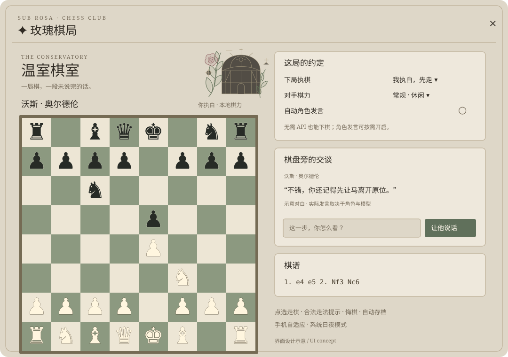

# 玫瑰棋局 · Rose Chess

一个可直接安装到 **SillyTavern** 的国际象棋扩展。打开当前角色的单人聊天，点棋子落子；无需连接 API 也能完成一局。可选地在插件内单独配置 API，让角色结合人设、聊天上下文与真实棋局发言，**与酒馆当前连接完全分开**。



> 上图是界面设计示意。当前版本：**1.1.0（独立 API 版）**。规则、异步状态与独立 API 模拟测试已通过；尚未完成真实酒馆中的端到端界面与付费 API 联调。欢迎反馈所用酒馆版本和报错。

## 安装

1. 打开酒馆顶部 **扩展 → 安装扩展**。
2. 粘贴仓库地址：

   ```text
   https://github.com/riserein/chess
   ```

3. 安装完成后刷新页面。打开一个角色的**单人聊天**。
4. 点右侧悬浮的 **♞**，或在扩展设置中点 **打开玫瑰棋局**。

仓库根目录就是插件根目录，不需要 npm 安装或构建。建议使用当前稳定版 SillyTavern；声明的最低客户端版本为 1.13.0。TauriTavern 等分支需支持同样的前端扩展、ES modules、Worker 和 `SillyTavern.getContext()` 接口，尚未单独验证。

如果需要手动安装，下载仓库 ZIP，将包含 `manifest.json` 的整个文件夹命名为 `chess`，放到酒馆的 `data/<用户目录>/extensions/chess`，然后刷新。不要把它当作主题 JSON 导入。

## 怎么玩

- 默认你执白，先走。**点棋子，再点标出的落点**；升变时可选择后、车、象、马。
- 在“下局执棋”选择白或黑，点“新开一局”后生效。当前棋局的颜色不会被中途改掉。
- 棋力有轻松、常规、认真三档。内置轻量搜索对手，定位是休闲对弈，**不标注 Elo，也不是 Stockfish**。
- 支持合法走法、被将军提示、王车易位、吃过路兵、升变、将死、逼和及常见子力不足和棋。
- 三次重复、五十回合达到条件后可点“申报和棋”；五次重复、七十五回合自动和棋。这里的一回合指双方各走一步。
- “悔一回合”撤回你上一手和对手回应；计算中也可以悔棋或重新开始。
- “导出 PGN”保存可读棋谱。“备份棋局”导出 JSON，“导入备份”继续下棋。首版只导入自己的 JSON 备份，不提供通用 PGN 导入。
- 键盘可用方向键定位、回车或空格选格，Esc 收起棋盘。手机使用点按操作。

## 让角色根据棋局说话

**默认不会自动调用 API。**不启用发言功能时，走棋完全在浏览器本地运行，不需要 API Key，不下载模型，也不依赖 CDN。

打开一个角色的单人聊天，在棋盘右侧（手机端往下滚动）的 **独立 API 设置** 中配置：

1. 选择 **DeepSeek / 硅基流动 / 自定义兼容接口**。当前支持兼容的 Chat Completions API，不支持 Anthropic 原生 Messages 或 Responses API 格式。
2. 填写 API 地址与 API Key。例如 `https://api.deepseek.com/v1`。自建本地免密接口可以不填密钥。支持填基础地址或完整 `/chat/completions` 地址。
3. 手动填写模型 ID，或点 **加载模型** 获取列表后选择。模型列表需要接口支持 `/models`；无法加载时可以手填。
4. 点 **测试连接**，成功后点 **保存设置**。测试仅发送一条短测试消息，不包含角色卡或聊天内容；会消耗少量接口额度。
5. 可设置输出 token 上限和发送的最近聊天条数（0–20 条，默认 6 条）。

保存后任选一种发言方式：

1. 点 **让他说话**：发送一次棋局旁白请求。也可以先在棋盘旁的文本框输入一句话。
2. 打开 **自动角色发言**：选择每一、二、四回合说一次；棋局正常结束时也会尝试发言。

请求由插件直接发给你指定的 API 地址，使用插件自己的模型和密钥，**不会读取或改动酒馆的 API 配置，也不会调用酒馆的 `generateQuietPrompt()`**。即使酒馆主聊天没有连接 API，棋局发言也可以使用独立接口。

角色资料仍读取当前角色卡的名称、描述、性格、场景和玩家称呼，并按设置读取最近聊天。独立接口不会自动加载酒馆的主预设、世界书、正则、注入提示或其他扩展的提示内容。角色口吻取决于角色资料与所选模型。

**密钥保存**：默认只在当前页面内存中保留，刷新后需重新填写。只有勾选“在此浏览器保存密钥”才会将密钥以明文保存在当前站点的浏览器本地存储中；不会写入酒馆扩展设置、棋局备份、角色卡或本仓库。点击“清除密钥”可以移除当前与已保存的密钥。

**网络要求**：独立接口从浏览器发请求，服务需要允许你酒馆来源的 CORS 跨域请求。跨域被拒绝时，请使用允许浏览器请求的接口或中转；插件不内置服务端代理，也不会静默回退到酒馆 API。远程地址要求 HTTPS，`localhost`、`127.0.0.1`、`[::1]` 允许本地 HTTP。

插件会给角色提供 FEN、棋子位置、最近走法、吃子、升变和将军状态。**落子由本地规则引擎决定，语言模型只负责对话**，不会因为模型返回了一步非法走法而破坏棋局。语气会受角色卡、预设和模型影响，模型仍可能误读棋局。

发言会消耗**插件独立 API** 的额度；你选择的服务会收到角色资料、所选条数的最近聊天和棋局事实。独立棋盘里的对白不会被本插件主动插入主聊天，也不会主动执行角色卡状态变量更新。API 报错、超时或断开不会阻止你继续走棋。切换角色/聊天、悔棋或重开后，旧局面的延迟回复会被丢弃。

群聊暂不支持绑定角色发言；没有选中单个角色时可以本地练习。

## UI 与存档

- **Sub Rosa 温室棋室**：米灰羊皮纸 `#DED7C8`、旧黄铜细框、墨绿棋格、灰玫瑰点缀；原创植物与玻璃温室线描。
- 桌面双栏；窄屏自动改为上下排列。跟随系统切换炭灰夜间模式。
- 界面使用 Shadow DOM 隔离，尽量避免酒馆主题把按钮、棋盘或文字颜色改乱。
- 每个角色的每段聊天各自保存棋局。棋局和棋盘对白保存在**当前浏览器的本地存储**；不会随角色卡分发，也不会自动跨手机/电脑同步。跨设备请使用 JSON 备份。
- 棋力与自动发言等偏好使用酒馆扩展设置保存。清除浏览器数据前请导出重要棋局。

## 离线试玩

下载仓库中的 `demo.html`，双击打开即可试玩同一套棋局规则和棋力对手。试玩文件不调用 API，也不读取角色卡。浏览器需要支持 JavaScript、Blob Worker 与 Shadow DOM。

## 测试与开发

运行环境：Node.js 20 或更新版本；没有 npm 依赖。

```sh
npm test
npm run build
```

`npm run build` 只用于重新生成独立的 `demo.html`，安装扩展本身不需要构建。测试包括初始局面与 Kiwipete 的 perft、易位、吃过路兵中的牵制、四种升变、SAN、终局、重复计数、悔棋/重开时的异步取消、角色切换后丢弃旧 API 回复、API 故障与无 API 对弈，以及独立 URL/模型/鉴权、密钥保存选择、模型列表、超时取消和不调用酒馆主 API。

主要文件：`chess-core.js` 规则与搜索；`engine-worker.js` 棋力后台线程；`game.js` 棋局状态；`api.js` 独立接口与配置；`character.js` 角色资料与发言提示；`panel.js` / `panel.css` 界面；`index.js` 扩展接入。

## 更新记录

- **1.1.0**：独立 API 地址、密钥、模型选择、加载模型与连接测试；可设置输出上限和聊天条数；密钥默认只存内存，另提供浏览器保存选项；移除与酒馆主 API 的绑定。
- **1.0.0**：本地国际象棋、三档棋力、温室棋室 UI、存档与可选角色发言。

已安装的用户：在酒馆 **扩展 → 管理扩展** 中更新此插件，刷新后打开棋盘，展开 **独立 API 设置**。旧版的主 API 配置不会自动迁入，也无需重新安装角色卡。

官方接口参考：[SillyTavern UI Extensions](https://docs.sillytavern.app/for-contributors/writing-extensions/)。

## 许可

MIT。棋局规则、搜索与植物图稿为本项目代码，无第三方棋力引擎或 CDN 素材依赖。
